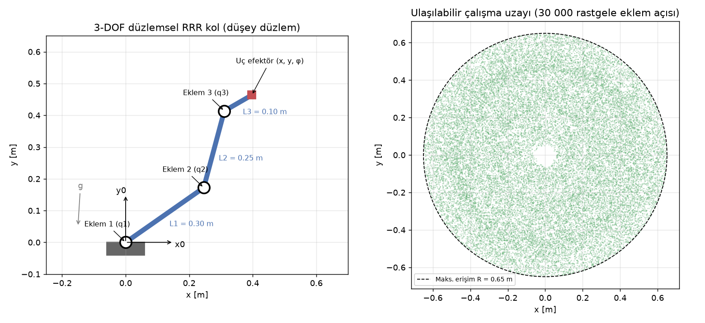

# 🦾 Robot Manipülatörleri — Temelden Uygulamaya

Robot kol tasarımının 10 temel konusunu **tek bir örnek kol** üzerinden anlatan bir çalışma deposudur. Her konu bir teori sayfasından ve somut bir çıktıdan oluşur: şema, hesap, kod, grafik veya liste. Sayfalardaki tüm sayılar ve grafikler depodaki Python kodlarından üretilmiştir.



**Örnek kol:** Düşey düzlemde çalışan 3 eklemli düzlemsel RRR kol. Uzuv boyları $L_1 = 0.30$ m, $L_2 = 0.25$ m, $L_3 = 0.10$ m. Yük kapasitesi 0.5 kg.

## 🧭 Nereden başlamalıyım?

> **Robot kolu tek cümleyle anlatmak gerekirse:** Motorlar (4) eklemleri çevirir, kontrolcü (5) motorların doğru açıda durmasını sağlar. Kinematik (1–2) açıları "elin nerede olduğu" bilgisine çevirir. Yörünge planlama (3) elin oraya nasıl gideceğini belirler. Kamera (8) hedefi bulur, tutucu (6) nesneyi kavrar. Yazılım (7) bütün bu parçaları birbirine bağlar, güvenlik (9) de insanları korur.

**Her sayfa aynı düzende ilerler:**

| Bölüm | Ne var? |
|---|---|
| 🎯 **Kısaca** | Konunun özü, 3–4 cümleyle |
| 🧠 **Benzetme** | Günlük hayattan bir örnek |
| 📐 Teori ve 💻 uygulama | Formüller, kod çıktıları ve grafikler |
| ⚡ **Akılda kalsın** | Sayfanın 4 maddelik özeti |
| ✍️ **Kendini test et** | Cevabı tıklayınca açılan sorular |

**Önerilen okuma sırası:** 0 → 1 → 2 → 3 → 4 → 5. Bunlar kolun "beyni ve kası". Ardından 6–9 istediğin sırayla okunabilir.

**Yardımcı sayfalar:**
- 🎮 **[İnteraktif laboratuvar](https://hamzasvr3030-dotcom.github.io/robot-manipulator/interaktif.html):** 5 bölüm var: düz kinematik, ters kinematik, yörünge, tork ve PID. Her bölümde hazır örnekler, canlı adım adım hesap ve "ne görüyorsun?" açıklamaları bulunuyor.
- 🌐 **[Web sitesi](https://hamzasvr3030-dotcom.github.io/robot-manipulator/):** Bu sayfaların menülü, açık/koyu temalı ve formülleri düzgün gösteren sürümü.
- 📖 **[Terimler sözlüğü](SOZLUK.md):** "DOF neydi?", "Tekillik ne demek?" gibi sorular için 48 terimin sade açıklaması.

## 📚 Konular

| # | Konu | Ne yapılıyor? | Çıktı |
|---|------|---------------|-------|
| 0 | [Robot manipülatör temelleri](konular/00-temeller.md): eklem tipleri, serbestlik derecesi, çalışma uzayı | Seçilen kol şemada anlatılıyor | 🖼️ Şema |
| 1 | [Düz kinematik](konular/01-duz-kinematik.md): dönüşüm matrisleri, DH parametreleri | Verilen kolun uç nokta konumu hesaplanıyor | 🧮 Hesap |
| 2 | [Ters kinematik](konular/02-ters-kinematik.md): analitik ve sayısal çözüm | 3 eklemli kol için IK çözülüyor | 💻 Kod |
| 3 | [Eklem uzayı ve kartezyen yörünge planlama](konular/03-yorunge-planlama.md) | Basit bir yörünge üretiliyor | 📈 Grafik |
| 4 | [Motorlar](konular/04-motorlar.md): servo, step, BLDC, tork, redüktör, sürücü seçimi | Eklem torkları hesaplanıyor | 📊 Hesap sayfası |
| 5 | [Kontrol](konular/05-kontrol.md): PID, konum/hız döngüsü, geri besleme | Eklem takibi simüle ediliyor | 📈 Grafik |
| 6 | [Tutucu (gripper) tasarımı ve temel sensörler](konular/06-tutucu.md) | Tutucu seçenekleri karşılaştırılıyor | 📝 Not |
| 7 | [Yazılım](konular/07-yazilim.md): URDF, ROS 2, MoveIt 2, Python | Model yükleniyor, hareket planlanıyor | 📦 Depo |
| 8 | [Algılama](konular/08-algilama.md): kamera, nesne konumu, kamera–robot kalibrasyonu | Temel bir görüntü işleme örneği yapılıyor | 🖥️ Çıktı |
| 9 | [Güvenlik](konular/09-guvenlik.md): sıkışma/ezilme riski, acil durdurma, güç kesme | Güvenlik kontrol listesi hazırlanıyor | ✅ Liste |

📖 Tüm kaynaklar: **[KAYNAKLAR.md](KAYNAKLAR.md)**

## 🗂️ Depo yapısı

```text
robot-manipulator/
├── README.md               ← bu sayfa
├── KAYNAKLAR.md            ← kaynakça (28 kaynak)
├── konular/                ← 10 konu sayfası (teori + sonuçlar)
├── kod/
│   ├── robot_kol.py        ← ortak model: DH, düz/ters kinematik, Jacobian
│   ├── k00_sema.py … k08_goruntu.py   ← her konunun betiği
│   └── tork_hesap_sayfasi.csv         ← Konu 4 hesap sayfası (Excel'de açılır)
├── gorseller/              ← kodların ürettiği grafikler
├── urdf/rrr_kol.urdf       ← aynı kolun ROS modeli
└── ros2/                   ← RViz launch dosyası ve MoveIt 2 Python örneği
```

## ▶️ Çalıştırma

```bash
pip install -r requirements.txt     # yalnızca numpy + matplotlib
cd kod
python k01_duz_kinematik.py         # her betik sonucu ekrana yazar, grafiği gorseller/ klasörüne kaydeder
```

| Betik | Ürettiği çıktı |
|---|---|
| `k00_sema.py` | Kol şeması ve çalışma uzayı |
| `k01_duz_kinematik.py` | DH matrisleri ve uç konumu |
| `k02_ters_kinematik.py` | Analitik ve DLS çözümleri |
| `k03_yorunge.py` | Eklem uzayı ve kartezyen yörünge karşılaştırması |
| `k04_tork.py` | Tork tablosu ve CSV dosyası |
| `k05_pid.py` | P / PD / PID karşılaştırması |
| `k08_goruntu.py` | Nesne tespiti ve robot koordinatı |

Kendi kolunuzu denemek için `kod/robot_kol.py` içindeki `L` değerlerini ve `kod/k04_tork.py` başındaki girdileri değiştirmeniz yeterli.

ROS 2 / MoveIt 2 kısmı için: [konular/07-yazilim.md](konular/07-yazilim.md)

## ⚠️ Notlar
- Bu depo eğitim amaçlıdır. Güvenlik listesi gerçek bir risk değerlendirmesinin yerine geçmez.
- Python kodları çalıştırılıp doğrulandı. ROS 2 / MoveIt dosyaları resmî dokümantasyona göre yazıldı, ancak ROS kurulu bir makinede test edilmedi.
