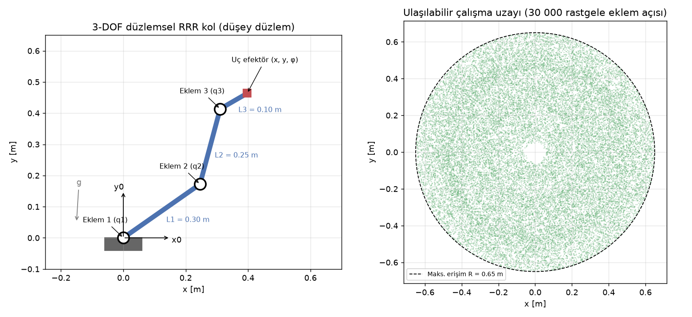

# 0 · Robot Manipülatör Temelleri

> **Çıktı türü:** Şema · **Kod:** [`kod/k00_sema.py`](../kod/k00_sema.py)

## 0.1 Manipülatör nedir?

Robot manipülatör, birbirine **eklemlerle** bağlanmış katı **uzuvlardan** (link) oluşan açık kinematik zincirdir. Zincirin bir ucu sabit **tabana**, diğer ucu işi yapan **uç efektöre** (tutucu, kaynak torcu, vakum vb.) bağlıdır [1, Bölüm 1], [2, Bölüm 1].

## 0.2 Eklem tipleri

| Eklem | Sembol | Hareket | Serbestlik | Örnek |
|---|---|---|---|---|
| Döner (revolute) | R | Bir eksen etrafında dönme | 1 | Endüstriyel kolların neredeyse tüm eklemleri |
| Prizmatik (prismatic) | P | Bir eksen boyunca öteleme | 1 | Kartezyen (gantry) robotlar, SCARA'nın z ekseni |
| Silindirik | C | Dönme + öteleme (aynı eksen) | 2 | — |
| Küresel (spherical) | S | Üç eksende dönme | 3 | Bilek (3 R eklemle gerçeklenir) |

Pratikte robotlarda neredeyse yalnızca **R** ve **P** eklemleri kullanılır. Çok serbestlikli eklemler bu iki tipin art arda dizilmesiyle elde edilir [3, Bölüm 2].

## 0.3 Serbestlik derecesi (DOF)

Bir mekanizmanın serbestlik derecesi **Grübler–Kutzbach** formülüyle hesaplanır [3, Bölüm 2.2]:

```math
\text{DOF} = m\,(N - 1 - J) + \sum_{i=1}^{J} f_i
```

Burada $m$ düzlemde 3, uzayda 6'dır. $N$ tabanla birlikte uzuv sayısı, $J$ eklem sayısı, $f_i$ ise $i$. eklemin serbestliğidir.

Açık zincirli seri bir kolda bu formül sadeleşir: **DOF = eklem serbestliklerinin toplamı.**

- Uzayda bir cismi **istenen konum ve yönelime** getirmek için 6 DOF gerekir (3 konum + 3 yönelim).
- Düzlemde bunun için 3 DOF yeterlidir: $(x, y, \varphi)$.
- DOF sayısı görevin gerektirdiğinden fazlaysa kola **artık serbestlikli (redundant)** denir. Örnek: 7 eksenli kollar. Fazla serbestlik engellerden kaçınmak için kullanılır.

## 0.4 Yaygın kol yapıları

| Yapı | İlk 3 eklem | Çalışma uzayı | Tipik kullanım |
|---|---|---|---|
| Kartezyen (gantry) | PPP | Dikdörtgenler prizması | 3B yazıcı, CNC, paletleme |
| Silindirik | RPP | Silindir | Montaj, makine besleme |
| Küresel (polar) | RRP | Küre kabuğu | Eski tip kaynak robotları |
| SCARA | RRP | Silindir | Hızlı al-yerleştir, elektronik montaj |
| Eklemli (antropomorfik) | RRR | Küre benzeri | Endüstriyel 6 eksenli kollar |

## 0.5 Çalışma uzayı (workspace)

- **Ulaşılabilir çalışma uzayı:** Uç efektörün *en az bir* yönelimle ulaşabildiği noktaların kümesi.
- **Becerikli (dexterous) çalışma uzayı:** Uç efektörün *her* yönelimle ulaşabildiği noktaların kümesi. Ulaşılabilir uzayın bir alt kümesidir [1, Bölüm 4.3].

Uzuv boylarına ek olarak **eklem sınırları** da çalışma uzayını daraltır.

## 0.6 Bu depoda kullanılan kol

Tüm konularda aynı model kullanılıyor: **düşey düzlemde çalışan 3 eklemli düzlemsel RRR kol**. Yerçekimi $-y$ yönünde etki eder.

| Parametre | Değer |
|---|---|
| Uzuv boyları $L_1, L_2, L_3$ | 0.30 m, 0.25 m, 0.10 m |
| Eklem sınırları | $q_1 \in [-180°, 180°]$, $q_2, q_3 \in [-150°, 150°]$ |
| Uç efektör pozu | $(x, y, \varphi)$, $\varphi = q_1+q_2+q_3$ |
| Maksimum erişim | $L_1+L_2+L_3 = 0.65$ m |



**Sağdaki grafiğin yorumu:** Çalışma uzayı 0.65 m yarıçaplı bir disktir. Merkezde küçük bir boşluk kalıyor, çünkü $q_2$ ve $q_3$ ±150° ile sınırlı olduğu için kol kendi üzerine tamamen katlanamıyor. Eklem sınırları olmasaydı iç sınırın yarıçapı $\max(0,\; L_1 - L_2 - L_3) = 0$ olurdu ve boşluk oluşmazdı.

**Neden bu kol?** 3 DOF, düzlemde konum ve yönelimi tam belirlemeye yetiyor. Bu sayede ters kinematiğin analitik çözümü elle türetilebiliyor. Aynı kavramlar (DH, Jacobian, tekillik) 6 eksenli kollara doğrudan genellenebilir.

## Kaynaklar
[1] Craig · [2] Spong vd. · [3] Lynch & Park. Tam künyeler: [KAYNAKLAR.md](../KAYNAKLAR.md)
