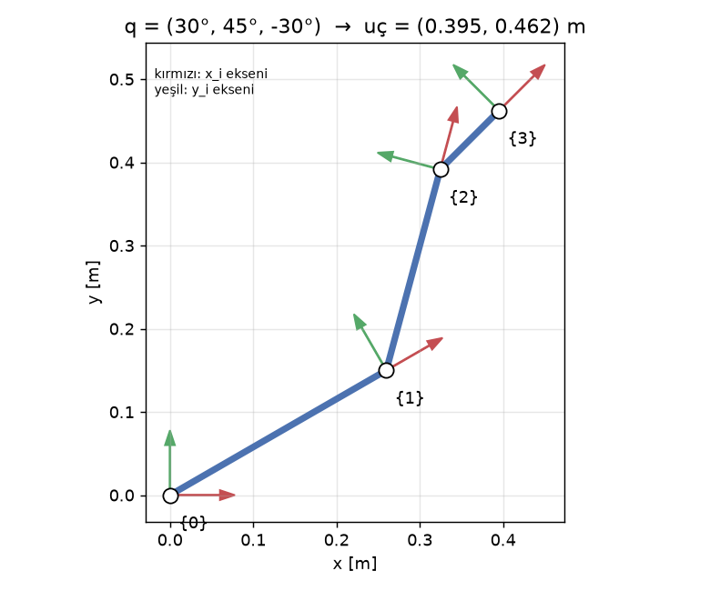

# 2 · Düz Kinematik: Dönüşüm Matrisleri ve DH Parametreleri

> **Çıktı türü:** Hesap · **Kod:** [`kod/k02_duz_kinematik.py`](../kod/k02_duz_kinematik.py), [`kod/robot_kol.py`](../kod/robot_kol.py)

> 📋 **Syllabus:** K2 · Düz kinematik · **Dönem:** P1 (12–15 Kasım) · **Tahmini süre:** 4 saat · **Öncelikli:** Kişi 4 (kinematik ve hareket planlama)  
> **Ön koşul:** [O1 · Matematik ve fizik](../ortak/o1-matematik-fizik.md) · **Ay sonu hedefi:** Verilen kol için uç nokta konumunu hesaplar · **Syllabus çıktısı:** Seçilen kol için uç nokta hesabı (kod) · [Proje planı](../plan.html)

> ### 🎯 Kısaca
> **Soru:** "Eklem açılarını biliyorum. Robotun eli (ucu) nerede?"
> Bu soruyu yanıtlamak için her uzvu bir **ok** gibi düşünüp okları uç uca eklemek yeterlidir. Matrisler ve DH yöntemi, bu toplama işini düzenli ve hatasız yapmaya yarayan araçlardır.

> 🧠 **Benzetme:** Gözlerin kapalı. Biri sana "omzunu 30° kaldır, dirseğini 45° bük" diyor. Parmak ucunun nerede olduğunu kafanda hesaplayabilirsin: Önce üst kolun nereyi gösteriyor, sonra ön kolun onun ucundan nereye uzanıyor. Düz kinematik tam olarak budur.

### Formülden önce sezgi (2 uzuvlu kol)

```text
          ● uç
         /
     L2 /  ← ikinci ok: açısı q1+q2
       /
      ● dirsek
     /
 L1 /  ← birinci ok: açısı q1
   /
  ■ taban
```

Her okun **yatay gölgesi** $L\cos(\text{açı})$, **dikey gölgesi** $L\sin(\text{açı})$ olur. Ucun konumu bu gölgelerin toplamıdır:

$x = L_1\cos q_1 + L_2\cos(q_1+q_2)$ ve $y = L_1\sin q_1 + L_2\sin(q_1+q_2)$

İkinci okun açısı $q_1+q_2$'dir, çünkü dirsek, üst kolun **zaten döndürdüğü** yönden itibaren döner. Formüllerin hepsi bundan ibaret. Aşağıdaki matrisler aynı işi 3B'de ve çok eklemli kollarda düzenli yapmanın yoludur.

<a class="lab-link" href="../interaktif.html#fk">🎮 Düz kinematik laboratuvarı: açıları oynat, hesabı adım adım izle →</a>

**Düz kinematik:** Eklem açıları $q$ verildiğinde uç efektörün konumunu ve yönelimini bulma problemidir. Çözümü her zaman vardır ve tektir.

## 2.1 Homojen dönüşüm matrisi

Bir çerçevenin başka bir çerçeveye göre **dönmesi** ($R$, 3×3) ve **ötelenmesi** ($p$, 3×1) tek bir 4×4 matriste birleştirilir [1, Bölüm 2], [3, Bölüm 3]:

```math
{}^{A}T_{B} = \begin{bmatrix} R & p \\ 0\;0\;0 & 1 \end{bmatrix},
\qquad
{}^{A}T_{C} = {}^{A}T_{B}\;{}^{B}T_{C}
```

Dönüşümler zincir boyunca **çarpılarak** birleşir. Örneğin $z$ ekseni etrafında $\theta$ kadar dönme:

```math
R_z(\theta) = \begin{bmatrix} \cos\theta & -\sin\theta & 0 \\ \sin\theta & \cos\theta & 0 \\ 0 & 0 & 1 \end{bmatrix}
```

## 2.2 Denavit–Hartenberg (DH) gösterimi

Denavit ve Hartenberg [6], ardışık iki eklem çerçevesi arasındaki dönüşümü **4 parametreyle** ifade etmeyi önerdi. Bu yöntemde çerçeveler kurallara göre yerleştirilir: $z_i$ eklem eksenidir, $x_i$ iki $z$ ekseninin ortak dikmesidir [2, Bölüm 3.2].

| Parametre | Anlamı |
|---|---|
| $a_i$ | Uzuv uzunluğu: $z_{i-1}$ ile $z_i$ arası, $x_i$ boyunca mesafe |
| $\alpha_i$ | Uzuv bükümü: $z_{i-1}$'den $z_i$'ye, $x_i$ etrafında açı |
| $d_i$ | Eklem kaçıklığı: $z_{i-1}$ boyunca mesafe (P eklemde değişken) |
| $\theta_i$ | Eklem açısı: $z_{i-1}$ etrafında açı (R eklemde değişken) |

Standart DH dönüşümü:

```math
{}^{i-1}T_{i} = R_z(\theta_i)\,T_z(d_i)\,T_x(a_i)\,R_x(\alpha_i) =
\begin{bmatrix}
c\theta_i & -s\theta_i c\alpha_i & s\theta_i s\alpha_i & a_i c\theta_i \\
s\theta_i & c\theta_i c\alpha_i & -c\theta_i s\alpha_i & a_i s\theta_i \\
0 & s\alpha_i & c\alpha_i & d_i \\
0 & 0 & 0 & 1
\end{bmatrix}
```

> ⚠️ Craig [1] **değiştirilmiş (modified) DH** kullanır: Parametrelerin sırası ve indeksleri farklıdır. Sonuç aynı çıkar, ama iki kitaptaki tablolar birbirine karıştırılmamalıdır.

## 2.3 Örnek kolun DH tablosu

| $i$ | $a_i$ [m] | $\alpha_i$ | $d_i$ | $\theta_i$ |
|---|---|---|---|---|
| 1 | 0.30 | 0 | 0 | $q_1$ |
| 2 | 0.25 | 0 | 0 | $q_2$ |
| 3 | 0.10 | 0 | 0 | $q_3$ |

Matrisler çarpılınca kapalı form elde edilir. Kısaltmalar: $c_{12} = \cos(q_1+q_2)$, $s_{123} = \sin(q_1+q_2+q_3)$ vb.

```math
x = L_1 c_1 + L_2 c_{12} + L_3 c_{123},\qquad
y = L_1 s_1 + L_2 s_{12} + L_3 s_{123},\qquad
\varphi = q_1 + q_2 + q_3
```

## 2.4 Hesap: $q = (30°,\,45°,\,-30°)$

Program çıktısı (`python kod/k02_duz_kinematik.py`):

```text
0_T_1 =                                1_T_2 =
[[ 0.866  -0.5     0.      0.2598]     [[ 0.7071 -0.7071  0.      0.1768]
 [ 0.5     0.866   0.      0.15  ]      [ 0.7071  0.7071  0.      0.1768]
 [ 0.      0.      1.      0.    ]      [ 0.      0.      1.      0.    ]
 [ 0.      0.      0.      1.    ]]     [ 0.      0.      0.      1.    ]]

2_T_3 =                                0_T_3 = 0_T_1 · 1_T_2 · 2_T_3 =
[[ 0.866   0.5     0.      0.0866]     [[ 0.7071 -0.7071  0.      0.3952]
 [-0.5     0.866   0.     -0.05  ]      [ 0.7071  0.7071  0.      0.4622]
 [ 0.      0.      1.      0.    ]      [ 0.      0.      1.      0.    ]
 [ 0.      0.      0.      1.    ]]     [ 0.      0.      0.      1.    ]]

Uç efektör konumu: x = 0.3952 m, y = 0.4622 m, phi = 45.0°
Kapalı form kontrol: x = 0.3952 m, y = 0.4622 m  (fark: 5.6e-17)
```

**Elle doğrulama:**
- $x = 0.30\cos 30° + 0.25\cos 75° + 0.10\cos 45° = 0.2598 + 0.0647 + 0.0707 = 0.3952$ m ✔
- $y = 0.30\sin 30° + 0.25\sin 75° + 0.10\sin 45° = 0.1500 + 0.2415 + 0.0707 = 0.4622$ m ✔
- $\varphi = 30 + 45 - 30 = 45°$. Bu sonuç $0T_3$'ün dönme bloğunda da görülüyor: $\cos 45° = 0.7071$ ✔



## 2.5 Jacobian (sonraki konular için)

Eklem hızlarını uç hızlarına bağlayan matris $\dot{\mathbf{x}} = J(q)\,\dot{q}$ ile tanımlanır [2, Bölüm 4]:

```math
J(q) = \begin{bmatrix}
-(L_1 s_1 + L_2 s_{12} + L_3 s_{123}) & -(L_2 s_{12} + L_3 s_{123}) & -L_3 s_{123} \\
L_1 c_1 + L_2 c_{12} + L_3 c_{123} & L_2 c_{12} + L_3 c_{123} & L_3 c_{123} \\
1 & 1 & 1
\end{bmatrix}
```

$\det J = L_1 L_2 \sin q_2$ olduğu için $q_2 = 0$ veya $q_2 = \pm 180°$ konumlarında kol **tekil (singular)** olur. Bu konumlarda kol tam açılmış ya da kendi üzerine katlanmıştır ve bazı yönlerde hareket edemez. $J$ aynı zamanda statik kuvvet ilişkisini de verir: $\tau = J^{T} F$ [3, Bölüm 5].

## ⚡ Akılda kalsın
- **Düz kinematik** = açılar → uç konumu. Sonuç **her zaman vardır ve tektir**.
- **Homojen matris** (4×4), "döndür + taşı" bilgisini tek pakette tutar. Matrisler **sırayla çarpılır**.
- **DH:** Her eklem 4 sayıyla tarif edilir ($a, \alpha, d, \theta$). Bu bir **kimlik kartı** gibidir.
- **Jacobian:** "Eklemleri biraz oynatırsam uç ne kadar oynar?" sorusunun cevabıdır. $\det J = 0$ olduğunda kol **tekildir** (kilitlenir).

## ✍️ Kendini test et
<details>
<summary><b>Syllabus (K2):</b> l1 = l2 = 0.3 m, θ1 = 90°, θ2 = −90° için uç nokta nedir?</summary>
<br>
x = 0.3·cos 90° + 0.3·cos(90° − 90°) = 0 + 0.3 = <b>0.3 m</b>, y = 0.3·sin 90° + 0.3·sin 0° = 0.3 + 0 = <b>0.3 m</b>. Uç (0.3, 0.3) m. Birinci uzuv dimdik yukarı, ikinci uzuv onun ucundan yatay olarak sağa uzanıyor ("Γ" şekli).
</details>
<details>
<summary><b>Soru:</b> q = (0°, 0°, 0°) iken uç nerededir?</summary>
<br>
x = 0.30 + 0.25 + 0.10 = 0.65 m, y = 0. Kol yatay ve tamamen açık.
</details>
<details>
<summary><b>Soru:</b> q = (90°, 0°, 0°) iken uç nerededir?</summary>
<br>
x = 0, y = 0.65 m. Kol dimdik yukarıyı gösteriyor.
</details>
<details>
<summary><b>Soru:</b> Kol neden q2 = 0° iken tekildir?</summary>
<br>
Kol tamamen açık. Ucu daha da uzağa itemezsin: O yönde hareket edemez, bir serbestlik kaybolur.
</details>

## Kaynaklar
[1] Craig · [2] Spong vd. · [3] Lynch & Park · [6] Denavit & Hartenberg. Tam künyeler: [KAYNAKLAR.md](../KAYNAKLAR.md)

---
[← 1 · Temeller](01-temeller.md) · [🏠 Ana sayfa](../README.md) · [📖 Sözlük](../SOZLUK.md) · [3 · Ters kinematik →](03-ters-kinematik.md)
