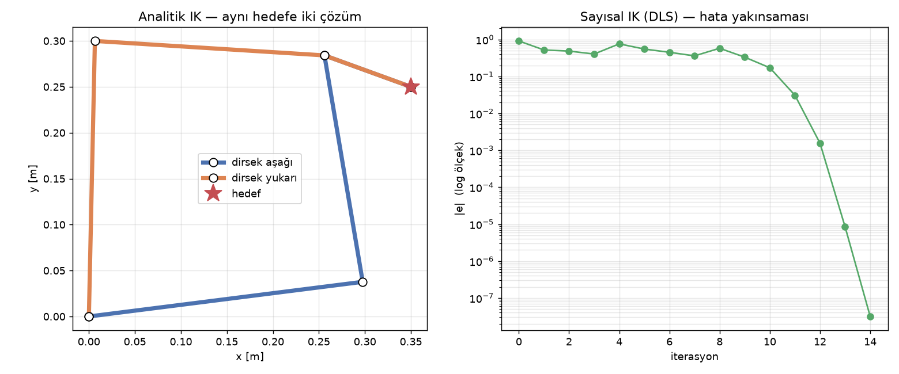

# 3 · Ters Kinematik: Analitik ve Sayısal Çözüm

> **Çıktı türü:** Kod · **Kod:** [`kod/robot_kol.py`](../kod/robot_kol.py) (`ters_kinematik_analitik`, `ters_kinematik_sayisal`), [`kod/k03_ters_kinematik.py`](../kod/k03_ters_kinematik.py)

> 📋 **Syllabus:** K3 · Ters kinematik · **Dönem:** P2 (16–20 Kasım) · **Tahmini süre:** 5 saat · **Öncelikli:** Kişi 4 (kinematik ve hareket planlama)  
> **Ön koşul:** [O1 · Matematik ve fizik](../ortak/o1-matematik-fizik.md) · **Ay sonu hedefi:** 2–3 eklemli kol için çözer · **Syllabus çıktısı:** Ters kinematik çözücü ve test noktaları · [Proje planı](../plan.html)

> ### 🎯 Kısaca
> **Soru:** "Elimi şu noktaya götürmek istiyorum. Eklemleri kaç dereceye çevirmeliyim?"
> Bu, düz kinematiğin **tersidir** ve daha zordur. Bazen hiç cevap yoktur (nokta çok uzaktadır), bazen birden fazla cevap vardır.

> 🧠 **Benzetme:** Masadaki bardağa uzan. Aynı bardağa **dirseğin aşağıdayken** de, **dirseğin yukarıdayken** de ulaşabilirsin. Bu ikisi aynı hedefin iki farklı çözümüdür. Bardak kolunun yetişmeyeceği kadar uzaktaysa çözüm yoktur.

**İki çözüm yolu var:**

| Yol | Nasıl çalışır? | Benzetme |
|---|---|---|
| **Analitik** | Geometri (üçgen + kosinüs teoremi) ile cevabı formülle **bir seferde** bulur | Haritaya bakıp adresi doğrudan bulmak |
| **Sayısal** | Bir tahminle başlar, "sıcak-soğuk" oyunu gibi her adımda hedefe biraz yaklaşır | Karanlıkta duvara dokuna dokuna kapıyı bulmak |

<a class="lab-link" href="../interaktif.html#ik">🎮 Ters kinematik laboratuvarı: hedefe tıkla, iki çözümü gör →</a>

**Ters kinematik (IK):** İstenen uç efektör pozu $(x, y, \varphi)$ verildiğinde bu pozu sağlayan eklem açılarını $q$ bulma problemidir. Düz kinematiğin aksine:

- Çözüm **hiç olmayabilir**: hedef çalışma uzayının dışında olabilir.
- **Birden çok** çözüm olabilir: dirsek yukarı ve dirsek aşağı. 6 eksenli kollarda bu sayı 8'e çıkabilir.
- Artık serbestlikli kollarda çözüm sayısı **sonsuzdur** [1, Bölüm 4], [2, Bölüm 5].

## 3.1 Analitik (kapalı form) çözüm — geometrik yöntem

Yöntem, problemi **bilek noktasına** indirgemeye dayanır. Uçtan $L_3$ kadar geriye gidilince geriye 2 uzuvlu bir kol kalır.

**Adım 1 — Bilek noktası:**

```math
x_w = x - L_3\cos\varphi, \qquad y_w = y - L_3\sin\varphi
```

**Adım 2 — Kosinüs teoremiyle $q_2$:**

```math
\cos q_2 = \frac{x_w^2 + y_w^2 - L_1^2 - L_2^2}{2L_1L_2}, \qquad
q_2 = \operatorname{atan2}\!\left(\pm\sqrt{1-\cos^2 q_2},\; \cos q_2\right)
```

$|\cos q_2| > 1$ çıkıyorsa hedefe **ulaşılamaz**. $\pm$ işareti iki çözümü (dirsek aşağı ve dirsek yukarı) verir.

**Adım 3 — $q_1$ ve $q_3$:**

```math
q_1 = \operatorname{atan2}(y_w, x_w) - \operatorname{atan2}(L_2\sin q_2,\; L_1 + L_2\cos q_2), \qquad
q_3 = \varphi - q_1 - q_2
```

> 💡 Burada `atan` yerine **`atan2`** kullanılmalıdır: Dört bölgenin hepsinde doğru açıyı verir ve $x=0$'da sıfıra bölme hatası oluşmaz.

6 eksenli endüstriyel kollarda son üç eksen tek noktada kesişir (küresel bilek). Bu durumda aynı fikir uygulanır ve problem *konum* ile *yönelim* olarak iki parçaya ayrılır (Pieper çözümü) [1, Bölüm 4.6], [4, Bölüm 2.12].

## 3.2 Sayısal çözüm — sönümlü en küçük kareler (DLS)

Kapalı formu olmayan kollarda (örneğin bileği kesişmeyen ya da 7 eksenli kollarda) IK **iteratif** olarak çözülür. Her adımda hata $e = x_{hedef} - f(q)$ hesaplanır ve Jacobian ile bir düzeltme yapılır:

| Yöntem | Güncelleme | Not |
|---|---|---|
| Newton–Raphson | $\Delta q = J^{-1} e$ | Tekillikte $J^{-1}$ patlar |
| Jacobian transpozu | $\Delta q = \alpha J^{T} e$ | Basit, ama yavaş yakınsar |
| Sözde ters | $\Delta q = J^{+} e$ | Artık serbestlikli kollar için uygun |
| **DLS (Levenberg–Marquardt)** | $\Delta q = J^{T}(JJ^{T} + \lambda^2 I)^{-1} e$ | Tekilliğe yakın konumlarda kararlı kalır [7], [28] |

Sönüm katsayısı $\lambda$ küçük seçilirse yakınsama hızlı olur ama tekillikte adımlar büyür. Büyük seçilirse yöntem kararlı olur ama yavaş yakınsar. Kodda $\lambda = 0.01$ kullanıldı.

Sayısal yöntem başlangıç tahminine $q_0$ en yakın çözüme yakınsar. **Hangi çözümü bulacağımızı $q_0$ belirler.**

## 3.3 Sonuçlar

Hedef: $x = 0.35$ m, $y = 0.25$ m, $\varphi = -20°$

```text
Analitik (dirsek aşağı ): q = [   7.2166   92.3603 -119.5769] °   konum hatası = 2.8e-17 m
Analitik (dirsek yukarı): q = [ 88.7535  -92.3603  -16.3933] °   konum hatası = 1.0e-16 m

Sayısal (DLS, q0=[10. 10. 10.]°): q = [7.2166 92.3603 -119.5769] °  (14 iterasyon, son hata 3.2e-08)

(0.8, 0.0) hedefi: Hedef çalışma uzayı dışında (cos q2 = 2.250)
```



**Yorum:**
- İki analitik çözüm de hedefe makine hassasiyetinde ($10^{-16}$ m) ulaşıyor.
- DLS 14 iterasyonda dirsek aşağı çözümüne yakınsadı, çünkü $q_0 = (10°, 10°, 10°)$ bu çözüme daha yakın.
- Sağdaki grafikte hata logaritmik eksende hızla düşüyor. Bu, Newton tipi yöntemlerden beklenen **ikinci dereceden yakınsamaya** uygun.
- 0.8 m uzaktaki hedef 0.65 m'lik erişimin dışında kaldığı için reddedildi.

**Analitik ve sayısal yöntemin karşılaştırması:**

| | Analitik | Sayısal |
|---|---|---|
| Hız | Çok hızlı, sabit süre | İterasyon sayısına bağlı |
| Tüm çözümler | Hepsi elde edilir | Yalnızca $q_0$'a yakın olan |
| Genellik | Kola özel türetim gerekir | Her kolda çalışır |
| Kullanıldığı yer | Endüstriyel kontrolcüler, IKFast | MoveIt (KDL, TRAC-IK), simülasyon |

## ⚡ Akılda kalsın
- **Ters kinematik** = istenen uç konumu → açılar. Cevap **0, 1, 2 ya da sonsuz** sayıda olabilir.
- Analitik çözümün püf noktası: Uçtan $L_3$ kadar geri git ve problemi **2 uzuvlu üçgene** indir.
- Açı hesaplarında hep **`atan2`** kullan.
- Sayısal yöntem, başlangıç tahminine **en yakın** çözümü bulur. **DLS**, kol tekilliğe yaklaştığında yöntemin "çıldırmasını" önler.

## ✍️ Kendini test et
<details>
<summary><b>Soru:</b> Formülde cos q2 = 1.4 çıktı. Bu ne anlama gelir?</summary>
<br>
|cos q2| > 1 olamaz, demek ki hedef erişim alanının dışında. Kol o noktaya yetişemez.
</details>
<details>
<summary><b>Soru:</b> Sayısal IK'ya farklı bir başlangıç açısı verirsen ne olabilir?</summary>
<br>
Diğer çözüme (örneğin dirsek yukarı) yakınsayabilir. Hangi çözümün bulunacağını başlangıç tahmini belirler.
</details>

## Kaynaklar
[1] Craig · [2] Spong vd. · [4] Siciliano vd. · [7] Buss · [28] Wampler. Tam künyeler: [KAYNAKLAR.md](../KAYNAKLAR.md)

---
[← 2 · Düz kinematik](02-duz-kinematik.md) · [🏠 Ana sayfa](../README.md) · [📖 Sözlük](../SOZLUK.md) · [4 · Yörünge →](04-yorunge-planlama.md)
