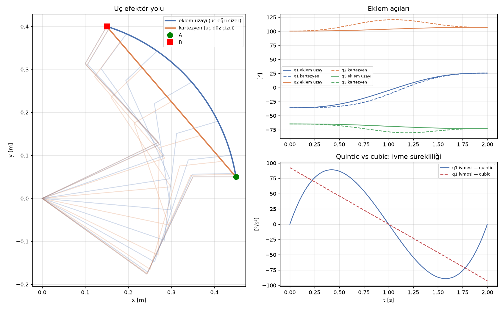

# 3 · Eklem Uzayı ve Kartezyen Yörünge Planlama

> **Çıktı türü:** Grafik · **Kod:** [`kod/k03_yorunge.py`](../kod/k03_yorunge.py)

**Yol (path)** yalnızca geometridir: hangi noktalardan geçileceğini söyler. **Yörünge (trajectory)** bu yola zamanı da ekler: her an konum, hız ve ivme bellidir [3, Bölüm 9], [8].

## 3.1 İki yaklaşım

| | Eklem uzayı | Kartezyen uzay |
|---|---|---|
| Ne interpole edilir? | Eklem açıları $q(t)$ | Uç efektör pozu $x(t)$ |
| Uç efektörün yolu | Öngörülemeyen bir eğri | İstenen geometri (örneğin düz çizgi) |
| IK ihtiyacı | Yalnızca başta ve sonda | **Her adımda** |
| Tekillik riski | Yok | Var: yol tekillikten geçerse eklem hızları patlar |
| Kullanım | Serbest hareket (MoveJ / PTP) | Kaynak, boyama, yerleştirme (MoveL / LIN) |

## 3.2 Zaman ölçekleme polinomları

$s(t)$, 0'dan 1'e giden bir parametredir ve yol $q(t) = q_A + s(t)(q_B - q_A)$ şeklinde tanımlanır. $\tau = t/T$ normalize zamanı göstermek üzere:

**Kübik (3. derece):** Başta ve sonda hız sıfırdır.

```math
s(\tau) = 3\tau^2 - 2\tau^3
```

**Beşinci derece (quintic):** Başta ve sonda hız **ve ivme** sıfırdır.

```math
s(\tau) = 10\tau^3 - 15\tau^4 + 6\tau^5
```

Kübik polinomda ivme başta ve sonda sıfır değildir. Bu yüzden harekete başlarken ve dururken ivme **sıçrar**, yani sarsıntı (jerk) sonsuz olur. Bu sıçrama mekanizmada titreşim yaratır ve redüktörü zorlar. Quintic polinom bu sorunu ortadan kaldırır [8, Bölüm 2].

Endüstride bunlara ek olarak **trapez hız profili** (sabit ivme, sabit hız, sabit yavaşlama) ve **S-eğrisi** (sarsıntısı sınırlı profil) de yaygın olarak kullanılır [3, Bölüm 9.2], [4, Bölüm 4].

## 3.3 Uygulama

A ve B pozları arasında $T = 2$ s'lik iki yörünge karşılaştırıldı:
- **A:** $(0.45,\ 0.05)$ m, $\varphi = 0°$
- **B:** $(0.15,\ 0.40)$ m, $\varphi = 60°$

```text
qA = [-35.9 100.6 -64.7]°,  qB = [ 25.7 107.2 -72.9]°
Uç efektör yol uzunluğu: eklem uzayı = 0.485 m, kartezyen = 0.461 m
Maks. eklem hızı (eklem uzayı, quintic) = 57.8 °/s
Maks. eklem ivmesi: quintic = 89.0 °/s², cubic = 92.5 °/s²
```



**Yorum:**
1. **Sol grafik:** Eklem uzayında planlanan yörüngede uç bir **yay** çiziyor ve yol 0.485 m oluyor. Kartezyen planlamada uç tam bir **düz çizgide** gidiyor ve yol 0.461 m oluyor.
2. **Sağ üst grafik:** Eklem uzayında açılar düzgün S eğrileri çiziyor. Kartezyen yörüngede ise $q_2$ ve $q_3$ hareket sırasında bir **tepe** yapıyor: Düz çizgiyi korumak için eklemler son değerlerinin ötesine gidip geri dönmek zorunda kalıyor.
3. **Sağ alt grafik:** Kübik polinomun ivmesi $t = 0$ ve $t = 2$ s'de **sıfır olmayan bir değerle** başlayıp bitiyor, bu da ivmenin sıçradığı anlamına geliyor. Quintic polinomun ivmesi ise sıfırdan başlayıp sıfırda bitiyor. Tepe değerleri yakın (89 ve 92.5 °/s²), fark **süreklilikte**.

## Kaynaklar
[3] Lynch & Park · [4] Siciliano vd. · [8] Biagiotti & Melchiorri. Tam künyeler: [KAYNAKLAR.md](../KAYNAKLAR.md)
