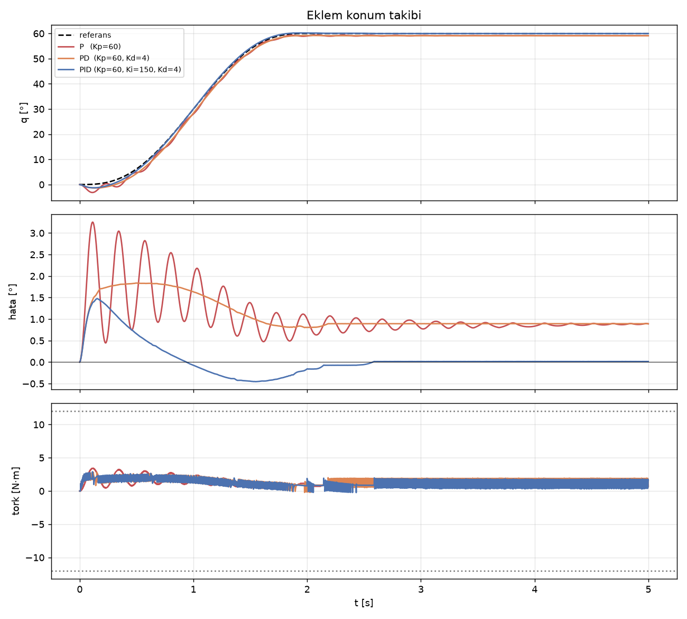

# 5 · Kontrol: PID, Konum/Hız Döngüsü, Geri Besleme

> **Çıktı türü:** Grafik · **Kod:** [`kod/k05_pid.py`](../kod/k05_pid.py)

> ### 🎯 Kısaca
> Motora "60°'ye git ve **orada kal**" dediğinde bunu nasıl başarır? Motor sürekli **ölçer** (enkoder), istenen değerle **karşılaştırır** ve aradaki farka (hataya) göre **düzeltir**. Bu döngü saniyede 1000 kez tekrarlanır. Düzeltme kuralı da **PID**'dir.

> 🧠 **Benzetme — duşun suyunu ayarlamak:**
> - **P (oransal):** Su çok soğuksa musluğu çok çevirirsin, az soğuksa az. Ama musluk bir yerde takılı kalırsa su hep biraz soğuk kalır. Bu **kalıcı hata**dır.
> - **I (integral):** "Bir süredir hâlâ biraz soğuk" diye düşünüp musluğu **zamanla** biraz daha açarsın. Kalıcı hata böyle kaybolur.
> - **D (türev):** Sıcaklık hızla yükseliyorsa musluğu açmayı **erkenden** bırakırsın. Böylece suyun aşırı ısınması (salınım) önlenir.

## 5.1 Kaskad kontrol yapısı

Endüstriyel servo sürücülerde üç kontrol döngüsü iç içe çalışır. İçteki döngü her zaman daha hızlıdır [2, Bölüm 6], [10]:

```text
 q_ref ─►[Konum (P)]─► ω_ref ─►[Hız (PI)]─► i_ref ─►[Akım (PI)]─► PWM ─► Motor ─┬─► q
            ▲  ~1 kHz             ▲  ~5 kHz              ▲  ~20 kHz             │
            └──────── enkoder ────┴──────── enkoder ─────┴── akım sensörü ──────┘
```

- **Akım döngüsü:** Torku ($\tau = K_t\,i$) doğrudan kontrol eder.
- **Hız döngüsü:** Sürtünmeyi ve yük değişimlerini bastırır.
- **Konum döngüsü:** Kola istenen yörüngeyi izletir.

## 5.2 Geri besleme sensörleri

| Sensör | Ölçtüğü | Çözünürlük | Not |
|---|---|---|---|
| Potansiyometre | Mutlak açı (analog) | ADC'ye bağlı (~0.1–0.5°) | Ucuz, aşınır, gürültülü. Hobi servolarda kullanılır |
| Artımlı (incremental) enkoder | Göreli açı (A/B darbeleri) | 1000–10000 darbe/tur, ×4 kenar sayımı | Açılışta referans noktası bulma (homing) gerekir |
| Mutlak enkoder (manyetik/optik) | Mutlak açı (SSI, SPI, BiSS) | 12–23 bit | Açılışta referans aramaya gerek kalmaz |
| Resolver | Mutlak açı (analog) | Yüksek | Çok dayanıklı. Havacılık ve ağır sanayide kullanılır |

## 5.3 PID kontrolcü

```math
u(t) = K_p\,e(t) + K_i\int_0^t e\,d\tau + K_d\,\frac{de}{dt}, \qquad e = q_{ref} - q
```

| Terim | Etkisi | Aşırısının zararı |
|---|---|---|
| $K_p$ | Hızlı tepki verir, hatayı küçültür | Salınım yapar |
| $K_i$ | **Kalıcı hatayı sıfırlar** (örneğin yerçekiminden kaynaklanan) | Aşma yapar. Doymada **integral şişmesi (windup)** oluşur |
| $K_d$ | Sönüm ekler, salınımı keser | Gürültüyü büyütür. **Filtre gerekir** |

Pratikte iki ek önlem şarttır [11]:
1. **Anti-windup:** Motor doymaya girdiğinde integral dondurulur.
2. **Filtrelenmiş türev:** Türev terimi alçak geçiren bir filtreden geçirilir. Bu örnekte 5 ms'lik birinci dereceden filtre kullanıldı.

## 5.4 Simülasyon

**Model:** Tek bir eklem simüle edildi. Eklem, ağırlığı olan bir uzvu düşey düzlemde kaldırıyor:

```math
J\ddot q + b\dot q + mgl\cos q = \tau, \qquad |\tau| \le 12\ \text{N·m}
```

| Parametre | Değer |
|---|---|
| Atalet $J$ | 0.08 kg·m² |
| Viskoz sürtünme $b$ | 0.15 N·m·s/rad |
| Yerçekimi katsayısı $mgl$ | 1.77 N·m |
| Enkoder | 4096 adım/tur (kuantalama modellendi) |
| Kontrol periyodu | 1 ms |
| Referans | 0° → 60°, 2 s'lik quintic yörünge |

```text
P   (Kp=60)                   maks |hata| =   3.25°   sürekli hal hatası = +0.890°   maks tork = 3.44 N·m
PD  (Kp=60, Kd=4)             maks |hata| =   1.84°   sürekli hal hatası = +0.893°   maks tork = 2.82 N·m
PID (Kp=60, Ki=150, Kd=4)     maks |hata| =   1.47°   sürekli hal hatası = +0.015°   maks tork = 2.91 N·m
```



**Yorum:**
- **P kontrolcü:** Salınım yapıyor (kırmızı eğri) ve **0.89° kalıcı hata** bırakıyor. Kalıcı hatanın nedeni şu: Hata sıfır olsaydı motor tork üretmezdi, ama 60°'de yerçekimi torku $mgl\cos 60° = 0.88$ N·m. Bu yüzden kol, $K_p\,e = 0.88$ eşitliğini sağlayan $e = 0.88/60\ \text{rad} \approx 0.84°$'lik bir hatada dengeye geliyor. Simülasyondaki 0.89° bu hesaba çok yakın. Aradaki küçük fark enkoder kuantalamasından ve sürtünmeden kaynaklanıyor.
- **PD kontrolcü:** Salınımı sönümlüyor, ama kalıcı hatayı değiştirmiyor, çünkü türev terimi durağan haldeki hataya tepki vermez.
- **PID kontrolcü:** İntegral terimi yerçekimini zamanla karşılıyor ve hata **0.015°**'ye iniyor. Bu değer, enkoderin 0.088°'lik tek adımından bile küçük.
- **Tork grafiğindeki ince titreşim:** Enkoder kuantalamasından kaynaklanıyor. Gerçek sistemlerde de görülen bu etki, daha yüksek çözünürlüklü enkoder veya daha güçlü türev filtresiyle azaltılabilir.

**Daha iyi kontrol yöntemleri:** Kontrolcüye yerçekimi telafisi olarak $mgl\cos q_{ref}$ ve ileri besleme olarak $J\ddot q_{ref}$ eklenirse PID'nin iş yükü büyük ölçüde azalır. Bu yaklaşım **hesaplanmış tork (computed torque)** kontrolüne giden yoldur [2, Bölüm 8], [4, Bölüm 8].

## ⚡ Akılda kalsın
- **Kapalı çevrim** = ölç → karşılaştır → düzelt döngüsü. Bu döngü **sensör** (enkoder) olmadan çalışmaz.
- **P** hızlı tepki verir ama kalıcı hata bırakır. **I** hatayı sıfırlar. **D** salınımı söndürür.
- Gerçek sistemde iki ek önlem şarttır: **anti-windup** (motor doyunca integrali durdur) ve **türev filtresi** (gürültüyü büyütme).
- Robot kolunda kalıcı hatanın sebebi **yerçekimidir**. Bu yüzden integral terimi veya yerçekimi telafisi gerekir.

## ✍️ Kendini test et
<details>
<summary><b>Soru:</b> Kol 90°'de (dimdik yukarı) dururken P kontrolcünün kalıcı hatası neden yok?</summary>
<br>
cos 90° = 0, yani bu konumda yerçekimi torku sıfır. Motorun bir şeyi taşıması gerekmediği için hata da gerekmiyor.
</details>
<details>
<summary><b>Soru:</b> Kp'yi iki katına çıkarırsan kalıcı hata ne olur?</summary>
<br>
Yaklaşık yarıya iner (e = τ_g / Kp), ama salınım artar. Hatayı tamamen sıfırlamanın yolu I terimidir.
</details>

## Kaynaklar
[2] Spong vd. · [4] Siciliano vd. · [10] Åström & Murray · [11] Åström & Hägglund. Tam künyeler: [KAYNAKLAR.md](../KAYNAKLAR.md)

---
[← 4 · Motorlar](04-motorlar.md) · [🏠 Ana sayfa](../README.md) · [📖 Sözlük](../SOZLUK.md) · [6 · Tutucu →](06-tutucu.md)
