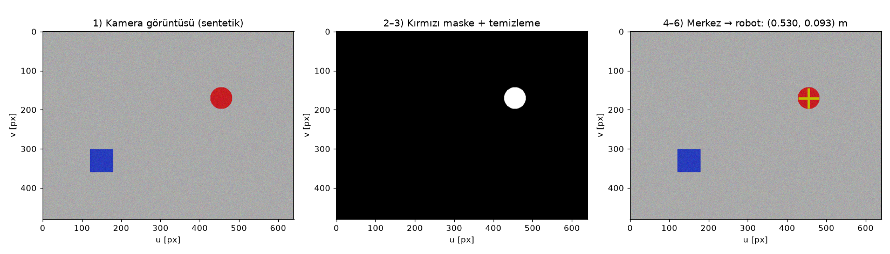

# 8 · Algılama: Kamera, Nesne Konumu, Kamera–Robot Kalibrasyonu

> **Çıktı türü:** Çıktı · **Kod:** [`kod/k08_goruntu.py`](../kod/k08_goruntu.py)

**Amaç:** Kamerada görülen bir nesnenin konumunu **robot tabanına göre** metre cinsinden bulmak ve kolu oraya göndermek. Bunun için iki dönüşüm gerekir:

```text
piksel (u,v) ──[iç parametreler K]──► kamera çerçevesi (X,Y,Z) ──[el-göz kalibrasyonu T_rc]──► robot tabanı
```

## 8.1 Kamera modeli: iğne deliği (pinhole)

Kameranın bir 3B noktayı görüntüye nasıl düşürdüğü şu modelle ifade edilir [20, Bölüm 6]:

```math
\lambda\begin{bmatrix}u\\v\\1\end{bmatrix} = K\begin{bmatrix}X\\Y\\Z\end{bmatrix},
\qquad
K = \begin{bmatrix} f_x & 0 & c_x \\ 0 & f_y & c_y \\ 0 & 0 & 1 \end{bmatrix}
```

- **İç parametreler** ($K$ matrisi ve lens bozulma katsayıları), satranç tahtası desenli fotoğraflarla **Zhang yöntemiyle** bulunur [17]. OpenCV'de karşılığı `cv2.calibrateCamera` fonksiyonudur [19].
- **Tek kamerada derinlik kaybolur.** $Z$ (derinlik) bilinmiyorsa piksel yalnızca bir **ışın** tanımlar. $Z$ üç yoldan elde edilebilir:
  - Nesne bilinen bir masa düzleminde duruyordur.
  - Derinlik kamerası kullanılır (RealSense, ZED vb.).
  - Stereo kamera kullanılır.

## 8.2 Kamera–robot (el-göz) kalibrasyonu

| Yapı | Kamera nerede? | Bulunan dönüşüm |
|---|---|---|
| **Eye-to-hand** | Sabit, robotu dışarıdan görür | Kamera → robot tabanı ($T_{rc}$) |
| **Eye-in-hand** | Robotun ucunda | Kamera → uç efektör ($T_{ec}$) |

Robot farklı pozlara götürülür ve her pozda kalibrasyon deseni görüntülenir. Bu ölçümlerden $AX = XB$ denklemi kurulur ve bilinmeyen $X$ dönüşümü çözülür. Klasik çözüm **Tsai–Lenz** yöntemidir [18]. OpenCV'deki karşılığı `cv2.calibrateHandEye` fonksiyonudur [19].

## 8.3 Örnek: renkli nesneyi bul, robot koordinatına çevir

Örnekte ek kütüphane gerekmesin diye **sentetik bir görüntü** ve yalnızca numpy kullanıldı. Senaryo şöyle: Kamera masanın 0.80 m üzerinde, aşağı bakıyor (eye-to-hand). İç parametreler $f_x = f_y = 600$ px ve $c = (320, 240)$.

| Adım | Bu koddaki işlem | OpenCV karşılığı |
|---|---|---|
| 1. Görüntü al | Sentetik görüntü + gürültü | `cv2.VideoCapture` |
| 2. Renk eşikleme | `(R>140) & (G<100) & (B<100)` | `cv2.cvtColor(..., HSV)` + `cv2.inRange` |
| 3. Gürültü temizleme | Komşu sayısına göre filtreleme | `cv2.morphologyEx(OPEN)` |
| 4. Ağırlık merkezi | Maske piksellerinin ortalaması | `cv2.moments` |
| 5. Piksel → kamera | $[X,Y,Z]^T = Z\,K^{-1}[u,v,1]^T$ | `cv2.undistortPoints` + aynı formül |
| 6. Kamera → robot | $p_r = T_{rc}\,p_c$ | `calibrateHandEye` sonucu |

**Çıktı:**

```text
Bulunan nesne alanı: 2409 piksel
Merkez (piksel): u = 455.0, v = 170.0   (gerçek: 455.0, 170.0)
Kamera çerçevesinde: [ 0.18   -0.0933  0.8   ] m
Robot tabanına göre: x = 0.5300 m, y = 0.0933 m, z = 0.0000 m
```



**Elle doğrulama:**
- Kamera çerçevesinde: $X = (455 - 320)\cdot 0.8 / 600 = 0.180$ m ve $Y = (170 - 240)\cdot 0.8/600 = -0.0933$ m ✔
- Robot tabanına çevirme: Kamera tabanın 0.35 m önünde ve y ekseni ters yönde. Bu yüzden robot koordinatı $x = 0.35 + 0.18 = 0.53$ m, $y = +0.0933$ m ✔
- Sonuç olarak nesne 0.53 m uzakta. Bu nokta kolun 0.65 m'lik erişim alanı içinde, yani Konu 2'deki IK ile kol nesneye gönderilebilir.

**Bir sonraki adımlar:**
- **ArUco/AprilTag işaretçileri:** Nesnenin konumuna ek olarak yönelimini de verir.
- **Derin öğrenme tabanlı nesne tespiti** (örneğin YOLO): Nesnelerin renk yerine sınıfa göre bulunmasını sağlar.
- **ROS 2'de bu zincirin karşılıkları:** `image_pipeline` ve `tf2` [13].

## Kaynaklar
[5] Corke · [13] ROS 2 Dokümantasyonu · [17] Zhang · [18] Tsai & Lenz · [19] OpenCV · [20] Hartley & Zisserman. Tam künyeler: [KAYNAKLAR.md](../KAYNAKLAR.md)
