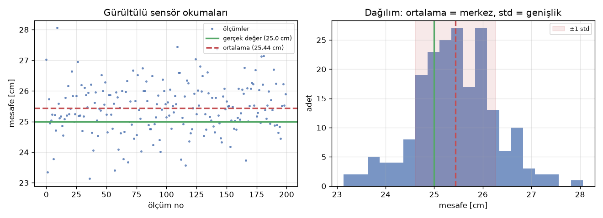

# O1 · Matematik ve Fizik Minimumu

> 📋 **Syllabus:** O1 · **Dönem:** P1 (12–15 Kasım) · **Tahmini süre:** 5 saat · **Kimler:** tüm ekip · **Çıktı:** Çözümlü soru kâğıdı · **Kod:** [`kod/o1_cozumlu.py`](../kod/o1_cozumlu.py)

> ### 🎯 Kısaca
> Robot kolu anlamak için ileri matematik gerekmez. Şu dört araç yeterlidir:
> 1. **Vektör ve matris:** "Nerede?" ve "Hangi yöne dönük?" sorularının dili.
> 2. **Trigonometri** (`sin`, `cos`, `atan2`): Açıyı konuma, konumu açıya çevirir.
> 3. **Türev ve integral:** "Ne kadar hızlı değişiyor?" ve "Ne kadar birikti?" soruları.
> 4. **Newton ve tork:** Bir şeyi hareket ettirmek için ne kadar kuvvet gerekir?
>
> Ölçümler her zaman gürültülüdür. **Ortalama** ve **standart sapma** bu gürültüyü sayıya döker.

> 🧠 **Benzetme:** Bir **harita** üzerinde düşün. Vektör "kuzeye 3 km, doğuya 4 km" demektir. Dönme matrisi, haritayı masada çevirmektir: Şehirler aynı yerde kalır, ama "kuzey" artık başka yöne bakar. Türev arabanın **hız göstergesi**, integral ise **kilometre sayacıdır**.

## O1.1 Vektörler ve matris çarpımı

Bir nokta veya yön, bileşenleriyle yazılır: $\mathbf{p} = (x, y)$. Matris çarpımında her satır, vektörle "skaler çarpılır":

```math
\begin{bmatrix} a & b \\ c & d \end{bmatrix}\begin{bmatrix} x \\ y \end{bmatrix} = \begin{bmatrix} a x + b y \\ c x + d y \end{bmatrix}
```

> ⚠️ Matris çarpımı **değişmeli değildir**: $AB \ne BA$. Robotta bu, "önce döndür sonra taşı" ile "önce taşı sonra döndür" işlemlerinin farklı sonuç vermesi demektir (Konu 2).

## O1.2 Dönme matrisi (2B ve 3B)

Düzlemde bir vektörü $\theta$ kadar **saat yönünün tersine** döndüren matris:

```math
R(\theta) = \begin{bmatrix} \cos\theta & -\sin\theta \\ \sin\theta & \cos\theta \end{bmatrix}
```

Dönme matrisinin özellikleri:
- **Uzunluğu korur**: Döndürülen vektörün boyu değişmez.
- **Tersi transpozuna eşittir**: $R^{-1} = R^{T}$.
- **Determinantı 1'dir.**

3B'de aynı fikir eksen başına uygulanır: $R_x$, $R_y$ ve $R_z$ matrisleri vardır. Konu 2'deki 4×4 **homojen dönüşüm matrisi**, dönme ve taşımayı tek bir pakette birleştirir.

## O1.3 `atan2` neden var?

`atan(y/x)`, $x$'in işaretini kaybeder. Örneğin (−1, −1) noktası ile (1, 1) noktası aynı sonucu verir. `atan2(y, x)` ise dört bölgenin hepsinde doğru açıyı verir:

| Nokta (x, y) | `atan(y/x)` | `atan2(y, x)` | Doğru açı |
|---|---|---|---|
| (+1, +1) | 45.0° | 45.0° | 45° |
| (−1, +1) | −45.0° ❌ | 135.0° | 135° |
| (−1, −1) | 45.0° ❌ | −135.0° | −135° (225°) |

Ters kinematikte açılar **her zaman** `atan2` ile hesaplanır (Konu 3).

## O1.4 Türev ve integral: değişim ve birikim

| Kavram | Anlamı | Robotta örnek |
|---|---|---|
| **Türev** $\dot q = dq/dt$ | Değişim hızı | Eklem açısı → açısal hız → açısal ivme |
| **İntegral** $\int e\,dt$ | Zaman içindeki birikim | PID'nin I terimi: "Hata ne kadar süredir var?" |

Bilgisayarda bu işlemler **küçük zaman adımlarıyla** yapılır. $\Delta t = 1$ ms için:
- Türev: $\dot q \approx (q_k - q_{k-1})/\Delta t$
- İntegral: $I_k = I_{k-1} + e_k\,\Delta t$

Konu 6'daki simülasyon tam olarak bu iki satırla çalışır.

## O1.5 Newton ve tork

```math
F = m\,a \qquad\qquad \tau = F \cdot d_{\perp} \qquad\qquad \tau = J\,\alpha
```

- **Tork**, kuvvet ile kaldıraç kolunun çarpımıdır. Buradaki kaldıraç kolu $d_\perp$, kuvvetin dönme eksenine olan **dik** uzaklığıdır.
- Dönen bir cisimde $F = ma$'nın karşılığı $\tau = J\alpha$'dır. $J$ atalet momenti, $\alpha$ açısal ivmedir.

Kolun yatay durduğu en kötü durumda yerçekimi torku $\tau = m g L$ olur (Konu 5).

## O1.6 Ortalama, standart sapma, gürültü

$N$ ölçüm $x_1 \dots x_N$ için:

```math
\bar x = \frac{1}{N}\sum x_i \qquad\qquad s = \sqrt{\frac{1}{N-1}\sum (x_i - \bar x)^2}
```

- **Ortalama**, ölçümlerin merkezidir.
- **Standart sapma**, ölçümlerin ne kadar **dağınık** olduğunu gösterir.
- **Gürültü**, ölçümün her seferinde rastgele oynamasıdır. Std'yi büyütür.
- **Sabit hata (bias)**, bütün ölçümlerin aynı yöne kaymasıdır. Ortalamayı gerçek değerden uzaklaştırır, ama std'yi değiştirmez. Bu hata ancak **kalibrasyonla** düzeltilir.



Yukarıdaki örnekte gerçek mesafe 25.0 cm. Sensöre 0.4 cm'lik sabit hata ve 0.8 cm'lik gürültü eklenip 200 ölçüm alındı:

```text
200 ölçüm: ortalama = 25.44 cm, std = 0.83 cm, ortalamanın std'si = 0.058 cm
```

Ortalama almak gürültüyü azaltır: Ortalamanın belirsizliği $s/\sqrt{N}$ ile küçülür. Ama **sabit hatayı asla gidermez**: Ortalama yine 25.44 cm çıkıyor, yani 0.44 cm hata duruyor.

## ✍️ Kendini sına (syllabus soruları)

<details>
<summary><b>1.</b> 30° dönme matrisini yazın ve (1, 0) noktasını döndürün.</summary>
<br>
R(30°) = [[cos30, −sin30], [sin30, cos30]] = [[0.866, −0.5], [0.5, 0.866]].<br>
R · (1, 0) = (0.866, 0.5). Nokta orijin etrafında 30° döndü, uzunluğu hâlâ 1. Kod çıktısı: <code>R · (1, 0) = [0.866 0.5]  (uzunluk: 1.0)</code>
</details>
<details>
<summary><b>2.</b> 0.5 kg yük, 0.3 m uzunluğunda yatay bir kolun ucunda. Eklemdeki statik tork nedir?</summary>
<br>
τ = m·g·L = 0.5 × 9.81 × 0.3 = <b>1.47 N·m</b>. Kol yatay olduğu için kaldıraç kolu tam L. Kol 60° kalksaydı tork 1.47 × cos 60° = 0.74 N·m olurdu.
</details>
<details>
<summary><b>3.</b> Bir sensör okumasının ortalaması ile standart sapması neyi anlatır?</summary>
<br>
Ortalama, ölçümün <b>nerede toplandığını</b> gösterir. Gerçek değerden farkı sabit hatadır (bias) ve kalibrasyonla düzeltilir. Standart sapma, ölçümün <b>ne kadar oynadığını</b> gösterir, yani gürültüdür. Std küçükse sensör tutarlıdır. Ama tutarlı olması doğru olduğu anlamına gelmez: Örnekteki sensör tutarlı, fakat sürekli 0.44 cm fazla ölçüyor.
</details>

## 🦾 Robot kolda nerede kullanılıyor?

| Bu sayfadaki araç | Kullanıldığı yer |
|---|---|
| Dönme ve homojen dönüşüm matrisi | [Konu 2 · Düz kinematik](../konular/02-duz-kinematik.md) |
| `atan2`, kosinüs teoremi | [Konu 3 · Ters kinematik](../konular/03-ters-kinematik.md) |
| Türev (hız, ivme) | [Konu 4 · Yörünge](../konular/04-yorunge-planlama.md) |
| Tork, $\tau = J\alpha$ | [Konu 5 · Motorlar ve tork](../konular/05-motorlar.md) |
| İntegral, gürültü | [Konu 6 · Kontrol](../konular/06-kontrol.md), [O6 · Simülasyon](o6-simulasyon-veri.md) |

## ⚡ Akılda kalsın
- Dönme matrisi uzunluğu korur ve tersi transpozudur. Matris çarpımında **sıra önemlidir**.
- Açı hesaplarında hep **`atan2`** kullan.
- Türev **değişim hızıdır**, integral **birikimdir**. Bilgisayarda ikisi de küçük adımlarla hesaplanır.
- Ortalama gürültüyü azaltır, ama **sabit hatayı gidermez**. Sabit hata kalibrasyonla düzeltilir.

## Kaynaklar
[3] Lynch & Park (Bölüm 2–3) · [29] Kreyszig · [30] Taylor. Tam künyeler: [KAYNAKLAR.md](../KAYNAKLAR.md)

---
[🏠 Ana sayfa](../README.md) · [📖 Sözlük](../SOZLUK.md) · [O2 · Elektrik ve güç →](o2-elektrik-guc.md)
