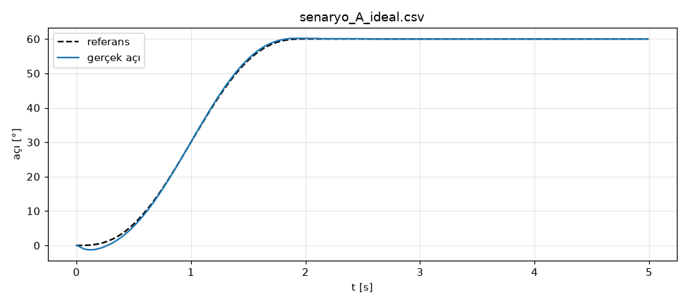

# O3 · Yazılım Altyapısı

> 📋 **Syllabus:** O3 · **Dönem:** P1 (12–15 Kasım) · **Tahmini süre:** 5 saat · **Kimler:** tüm ekip · **Çıktı:** Ekip deposu ve kod/commit kuralları · **Kod:** [`kod/o3_csv_grafik.py`](../kod/o3_csv_grafik.py)

> ### 🎯 Kısaca
> Beş kişinin aynı kod üzerinde çalışabilmesi için ortak bir **çalışma ortamı** ve ortak **kurallar** gerekir. Bu sayfada beş araç var:
> 1. **Linux** komut satırı
> 2. **Python** (numpy, matplotlib)
> 3. **Git** (sürüm kontrolü)
> 4. **Sanal ortam**
> 5. **Markdown** belgeleri
>
> Ayrıca motor kartlarındaki C/C++ kodunu okuyabilecek kadar temel bilgi.

> 🧠 **Benzetme:** Git, bir belgenin **"değişiklikleri izle"** özelliğinin süper hâlidir. Herkes kendi **kopyasında (branch)** çalışır. Bitince değişiklikler ana belgeye **birleştirilir (merge)**. Her kaydın (commit) kimin, ne zaman, neden yaptığı bilinir ve istenirse geri alınır.

## O3.1 Ortam seçimi

**Ubuntu 24.04 LTS + ROS 2 Jazzy** (uzun destekli sürüm). Syllabus kuralı: Sürüm ekipçe bir kez seçilir ve **proje boyunca değiştirilmez**. Windows kullanan üyeler WSL2 veya sanal makine kullanabilir.

## O3.2 Linux komut satırı — en çok kullanılanlar

| Komut | Ne yapar? | Örnek |
|---|---|---|
| `cd`, `ls`, `pwd` | Klasör değiştir, listele, neredeyim? | `cd ~/kol_ws/src && ls -la` |
| `grep` | Dosyalarda metin ara | `grep -rn "Kp" kod/` |
| `chmod` | Dosya izinleri | `chmod +x calistir.sh` |
| `ssh` | Uzaktaki bilgisayara bağlan | `ssh ekip@robot-pc.local` |
| `apt` | Paket kur | `sudo apt install ros-jazzy-moveit` |
| `cat`, `less`, `nano` | Dosya göster veya düzenle | `less veri/senaryo_A_ideal.csv` |

## O3.3 Python — bu projede gerekenler

```python
import numpy as np                        # sayısal hesap
import matplotlib.pyplot as plt           # grafik

uzuvlar = [0.30, 0.25, 0.10]              # liste
def erisim(L):                            # fonksiyon
    return sum(L)

class Eklem:                              # sınıf
    def __init__(self, ad, sinir_derece):
        self.ad, self.sinir = ad, np.radians(sinir_derece)

print(erisim(uzuvlar))                    # 0.65
```

**Sanal ortam:** Her proje kendi paket sürümlerini kullanır, böylece "bende çalışıyordu" sorunu önlenir.

```bash
python3 -m venv .venv && source .venv/bin/activate
pip install -r requirements.txt
```

## O3.4 Git iş akışı

```text
main ──●────────────●──────────────●──►     (her zaman çalışan kod)
        \          / merge (PR)    /
         ●──●──●──●               /         ozellik/ters-kinematik  (Kişi 4)
          \                      /
           ●───●───●───●────────●           ozellik/tork-hesabi     (Kişi 1)
```

| Adım | Komut |
|---|---|
| Depoyu indir | `git clone https://github.com/<kullanıcı>/<depo>.git` |
| Yeni dal aç | `git switch -c ozellik/tork-hesabi` |
| Değişiklikleri kaydet | `git add kod/k05_tork.py` → `git commit -m "ozellik: eklem 3 motor kütlesi eklendi"` |
| Gönder | `git push -u origin ozellik/tork-hesabi` |
| Birleştirme isteği aç | GitHub'da **Pull Request** aç, bir ekip arkadaşı inceleyip onaylasın |
| Güncel kalmak | `git switch main && git pull` |

### Ekip kod ve commit kuralları (çıktı)

1. **`main` dalına doğrudan commit atılmaz.** Her iş kendi dalında yapılır ve PR ile birleştirilir. Her PR'ı en az 1 kişi inceler.
2. **Dal adları:** `ozellik/...`, `duzeltme/...`, `belge/...`, `deney/...` (örneğin `ozellik/urdf-tutucu`).
3. **Commit mesajı:** `tur: kısa açıklama`. Örnek: `duzeltme: IK'da eklem sınırı kontrolü eklendi`. Türler: `ozellik`, `duzeltme`, `belge`, `test`, `veri`, `duzen`.
4. **Bir commit = bir mantıklı değişiklik.** "Çeşitli düzeltmeler" gibi toplu commit atılmaz.
5. **Depoya konmayacaklar:** Şifreler, API anahtarları, kişisel veriler ve büyük ham dosyalar (video, rosbag). Bunların yerine `.gitignore` kullanılır. Büyük dosyalar paylaşılan sürücüde tutulur, depoya yalnızca bağlantısı konur.
6. **Her betik çalıştırılabilir olmalıdır.** Gerekli paketler `requirements.txt` dosyasında listelenir, kullanım bilgisi dosyanın başında yazar.
7. **Parametreler kodun başına** sabit olarak yazılır. Deney kayıtlarına hangi commit'te çalışıldığı not edilir (O6).

## O3.5 Markdown ve C/C++ okuma

- **Markdown:** Bu sitedeki bütün sayfalar Markdown ile yazıldı. `#` başlık, `**kalın**`, `| tablo |`, kod için üç ters tırnak kullanılır.
- **C/C++ okuma:** Motor kartları (Arduino, STM32) genelde C/C++ ile yazılır. Bu kodu okuyabilmek yeterlidir:

```cpp
const float KP = 60.0;               // sabit
volatile long enkoder_sayac = 0;     // kesmede değişen değişken → volatile
void loop() {                        // sürekli tekrar eden ana döngü
  float hata = hedef - konum_oku();
  analogWrite(PWM_PIN, constrain(KP * hata, 0, 255));   // PWM çıkışı (0–255)
}
```

## ✍️ Kendini sına (syllabus soruları)

<details>
<summary><b>1.</b> Bir depo açıp iki branch'te çalışın ve birleştirin.</summary>
<br>
<pre>git init deneme && cd deneme
echo "L1 = 0.30" > kol.txt && git add . && git commit -m "ilk"
git switch -c dal-a && echo "L2 = 0.25" >> kol.txt && git commit -am "dal-a: L2"
git switch main && git switch -c dal-b && echo "L3 = 0.10" > uc.txt && git add . && git commit -m "dal-b: L3"
git switch main && git merge dal-a && git merge dal-b
git log --oneline --graph</pre>
İki dal farklı dosyalara dokunduğu için çakışma olmaz. Aynı satırı iki dal birden değiştirseydi Git <b>çakışma (conflict)</b> bildirirdi. Bu durumda dosya elle düzeltilir, ardından <code>git add</code> ve <code>git commit</code> yapılır.
</details>
<details>
<summary><b>2.</b> Bir CSV dosyasını okuyup grafik çizen betik yazın.</summary>
<br>
Çözüm: <a href="../kod/o3_csv_grafik.py"><code>kod/o3_csv_grafik.py</code></a>. Bu betik O6'nın ürettiği <code>veri/senaryo_A_ideal.csv</code> dosyasını okur. Çıktısı:
<pre>500 satır, 4.99 s kayıt, sütunlar: t_s, referans_deg, gercek_deg, olcum_deg, tork_Nm
maks |hata| = 1.472°</pre>

</details>

## ⚡ Akılda kalsın
- Ortam ekipçe **bir kez** seçilir: Ubuntu 24.04 + ROS 2 Jazzy.
- Her iş **kendi dalında** yapılır. `main`'e yalnızca incelenmiş PR ile kod girer.
- Commit mesajı `tur: açıklama` biçimindedir. Şifre ve büyük dosya depoya girmez.
- Sanal ortam ve `requirements.txt` "bende çalışıyordu" sorununu önler.

## Kaynaklar
[13] ROS 2 Dokümantasyonu · [32] Chacon & Straub (Pro Git) · [33] Shotts. Tam künyeler: [KAYNAKLAR.md](../KAYNAKLAR.md)

---
[← O2 · Elektrik ve güç](o2-elektrik-guc.md) · [🏠 Ana sayfa](../README.md) · [📖 Sözlük](../SOZLUK.md) · [O4 · Kontrol ve PID →](o4-kontrol-pid.md)
