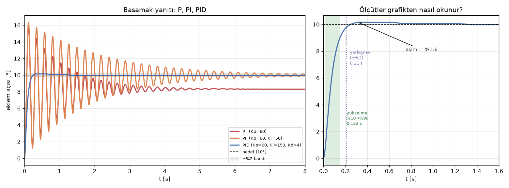

# O4 · Kontrol Temelleri ve PID

> 📋 **Syllabus:** O4 · **Dönem:** P2 (16–20 Kasım) · **Tahmini süre:** 6 saat · **Kimler:** tüm ekip, öncelik Kişi 3 (gömülü yazılım ve kontrol) · **Çıktı:** Simülasyonda P, PI ve PID karşılaştırma grafiği · **Kod:** [`kod/o4_adim_yaniti.py`](../kod/o4_adim_yaniti.py), [`kod/eklem_sim.py`](../kod/eklem_sim.py)

> ℹ️ Bu sayfa **dört takımın ortak** kontrol dersidir. Robot kola özel ayrıntılar (enkoder, kaskad döngü, yerçekimi telafisi, windup örnekleri) [Konu 6 · Kontrol](../konular/06-kontrol.md) sayfasında ve **[PID laboratuvarında](../interaktif.html#pid)** bulunur.

> ### 🎯 Kısaca
> **Geri besleme:** Ölç, hedefle karşılaştır, farka göre düzelt.
>
> ```math
> e = \text{hedef} - \text{ölçüm} \qquad u = K_p e + K_i \int e\,dt + K_d \frac{de}{dt}
> ```
>
> - **P** hızlandırır ama aşım yapabilir.
> - **I** kalıcı hatayı giderir ama doymada şişebilir (windup).
> - **D** sönüm sağlar ama gürültüye duyarlıdır.

> 🧠 **Benzetme:** Bir arabayı şerit ortasında tutmaya çalışıyorsun.
> - **P:** Ortadan ne kadar uzaksan direksiyonu o kadar çevirirsin.
> - **D:** Şeride hızla yaklaşıyorsan erkenden düzeltirsin. Böylece zikzak yapmazsın.
> - **I:** Rüzgâr seni hep sağa itiyorsa, zamanla direksiyonu biraz solda tutmayı öğrenirsin.

## O4.1 Yanıtı tarif eden dört ölçüt

Sisteme ani bir hedef değişikliği (**basamak**) verilir ve yanıt şu dört sayıyla tarif edilir:

| Ölçüt | Tanım | İyi değer |
|---|---|---|
| **Yükselme zamanı** | Yanıtın %10'dan %90'a çıkma süresi | Kısa: hızlı sistem |
| **Aşım** | Hedefin ne kadar geçildiği, yüzde olarak: $(q_{maks} - q_{hedef}) / q_{hedef}$ | Küçük (genelde < %10) |
| **Yerleşme zamanı** | Yanıtın ±%2 bandına girip bir daha çıkmadığı an | Kısa |
| **Kalıcı hal hatası** | Uzun süre sonra kalan fark | Sıfıra yakın |

## O4.2 P, PI ve PID karşılaştırması (çıktı)

Konu 6'daki eklem modeli kullanıldı. Kola **10°'lik ani bir komut** verildi. Bu adım motoru tork sınırına (12 N·m) dayatmayacak kadar küçük seçildi.

```text
                              yükselme    aşım  yerleşme  kalıcı hata  maks tork
P   (Kp=60)                     0.044s   58.3% yerleşmedi      +1.691°     10.47
PI  (Kp=60, Ki=50)              0.043s   63.6%    7.14 s      -0.004°     10.50
PID (Kp=60, Ki=150, Kd=4)       0.132s    1.6%    0.21 s      +0.024°     10.55
```



**Yorum:**
- **P:** Çok hızlı (0.044 s), ama %58 aşım yapıyor ve uzun süre salınıyor. Sonunda hedefin **1.7° altında** duruyor. Bu, yerçekiminden kaynaklanan kalıcı hatadır: $e = mgl\cos q / K_p$.
- **PI:** Kalıcı hatayı sıfırlıyor (−0.004°), ama salınım daha da uzun sürüyor: Ancak 7 saniyede yerleşiyor. İntegral sönüm **eklemez**, tersine azaltır.
- **PID:** D terimi sönüm ekliyor. Aşım %1.6'ya, yerleşme süresi 0.21 s'ye iniyor, kalıcı hata yok. Yükselme biraz yavaşlıyor (0.132 s), ama bu iyi bir takas.

> ⚠️ **Dikkat — PI kararsız olabilir:** Bu eklemde Ki = 150 ve Kd = 0 seçilirse sistem **kararsızdır**: Salınım sönmez, kol ±10° civarında sürekli sallanır. Kapalı çevrimin karakteristik denklemi $J s^3 + b s^2 + K_p s + K_i = 0$'dır. Routh–Hurwitz ölçütüne göre kararlılık için $b K_p > J K_i$, yani $K_i < 0.15 \cdot 60 / 0.08 = 112.5$ olmalıdır. Kd eklendiğinde koşul $(b + K_d) K_p > J K_i$ olur: 249 > 12. Bu yüzden PID kararlıdır. **Sönümü az bir sisteme D olmadan I eklemek tehlikelidir.**

## O4.3 Elle ayar sırası

1. **Ki = 0, Kd = 0.** Kp'yi yavaşça artır. Yanıt hızlı olsun ama hafif salınım yapsın.
2. **Kd'yi artır.** Salınım sönene kadar devam et. Gürültü yüzünden tork "diken diken" olmaya başlarsa dur ve türev filtresi kullan.
3. **Ki'yi küçükten başlatıp artır.** Kalıcı hata makul bir sürede kaybolana kadar devam et. Aşım büyümeye başlarsa geri al.
4. **Doyumu kontrol et.** Büyük komutlarda motor sınırına dayanılıyorsa **anti-windup** şarttır.
5. **Her denemeyi kaydet:** Parametreler, grafik ve ölçütler (O6 şablonu).

## O4.4 Kaskad döngü

Endüstriyel sürücülerde üç döngü iç içe çalışır: **akım (tork) → hız → konum**. İçteki döngü dıştakinden 5–10 kat hızlıdır. Her döngü içten dışa doğru, sırayla ayarlanır. Ayrıntısı ve şeması [Konu 6.1](../konular/06-kontrol.md) bölümündedir.

## ✍️ Kendini sına (syllabus soruları)

<details>
<summary><b>1.</b> Integral windup neden olur ve nasıl önlenir?</summary>
<br>
Motor <b>doyuma</b> girdiğinde, yani en fazla torkunu verdiğinde, hata hâlâ büyüktür ve integral birikmeye devam eder. Motor bu fazlalığı uygulayamaz, ama integral "hafızada" kalır. Hedefe gelindiğinde bu birikmiş değer kolu <b>hedefin ötesine iter</b> ve büyük aşım oluşur. Önlemek için <b>anti-windup</b> kullanılır: Çıkış doymadayken integral dondurulur (bu sitedeki simülatörde kullanılan yöntem) ya da sınırlanır. Laboratuvardaki "Integral şişmesi" örneğinde aşım anti-windup kapalıyken ≈25°, açıkken ≈2°.
</details>
<details>
<summary><b>2.</b> Sadece P ile ayarlanan bir sistemde kalıcı hata neden kalır?</summary>
<br>
P kontrolcünün tork üretebilmesi için <b>hatanın sıfırdan farklı olması</b> gerekir: u = Kp·e. Eklem yerçekimine karşı durmak için sürekli tork istiyorsa, bu torku üretecek kadar bir hata kalmak zorundadır: e = τ_yük / Kp. Örnekte 10°'de yerçekimi torku 1.739 N·m, e = 1.739/60 rad ≈ 1.66°. Simülasyonun verdiği değer 1.69°. Kp'yi büyütmek hatayı küçültür ama hiçbir zaman sıfırlamaz. Sıfırlamak için I terimi ya da yerçekimi telafisi gerekir.
</details>
<details>
<summary><b>3.</b> Bir adım yanıtı grafiğinden aşım yüzdesini okuyun.</summary>
<br>
Grafikte yanıtın <b>en yüksek noktası</b> bulunur. Aşım = (tepe − hedef) / hedef × 100. Sağdaki grafikte PID'nin tepesi ≈10.16°, hedef 10°. Aşım = 0.16/10 × 100 ≈ <b>%1.6</b>. Soldaki P eğrisinin tepesi ≈15.8°, aşım ≈ %58.
</details>

## ⚡ Akılda kalsın
- Yanıt dört ölçütle tarif edilir: **yükselme, aşım, yerleşme, kalıcı hata**.
- P hızlıdır ama kalıcı hata bırakır. I hatayı siler ama sönümü azaltır. D sönüm ekler ama gürültüyü büyütür.
- Sönümü az bir sistemde **D olmadan I eklemek kararsızlığa yol açabilir.**
- Ayar sırası: **Kp → Kd → Ki**, ardından doyum ve anti-windup kontrolü.

## Kaynaklar
[10] Åström & Murray (Bölüm 10–11) · [11] Åström & Hägglund. Tam künyeler: [KAYNAKLAR.md](../KAYNAKLAR.md)

---
[← O3 · Yazılım altyapısı](o3-yazilim-altyapisi.md) · [🏠 Ana sayfa](../README.md) · [📖 Sözlük](../SOZLUK.md) · [O5 · ROS 2 temelleri →](o5-ros2.md)
