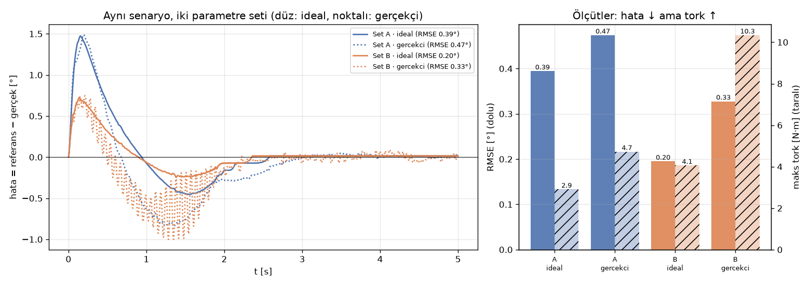

# O6 · Simülasyon ve Veri Analizi

> 📋 **Syllabus:** O6 · **Dönem:** P4 (7–20 Aralık) · **Tahmini süre:** 4 saat · **Kimler:** tüm ekip, öncelik Kişi 5 (simülasyon ve test) · **Çıktı:** Senaryo kayıt şablonu · **Kod:** [`kod/o6_senaryo.py`](../kod/o6_senaryo.py) · **Şablon:** [`sablonlar/senaryo_kaydi.md`](../sablonlar/senaryo_kaydi.md)

> ### 🎯 Kısaca
> Simülasyon, robotu kırmadan ve malzeme beklemeden deneme yapmayı sağlar. Ama **simülasyon gerçek değildir**: Sürtünme, gecikme, gürültü ve boşluk orada genelde idealdir.
>
> Bu sayfada iki şey öğreneceksin:
> 1. Bir deneyin nasıl **kaydedildiği**: veri, parametre, sürüm.
> 2. İki sonucun **sayılarla** nasıl karşılaştırıldığı: hata, RMSE, tekrarlanabilirlik.

> 🧠 **Benzetme:** Simülasyon, uçuş simülatörü gibidir. Pilot orada her şeyi dener, ama gerçek uçakta rüzgâr, titreşim ve gecikme vardır. İyi bir pilot simülatörde **neyin eksik olduğunu bilir** ve gerçek uçuşta önce yavaş ve güvenli manevralar yapar.

## O6.1 Fizik motoru ve model

| Ortam | Güçlü yanı | Not |
|---|---|---|
| **Gazebo** | ROS 2 ve MoveIt ile doğrudan çalışır, sensör simülasyonu yapar | Projenin simülasyon planındaki ana seçenek |
| **PyBullet** | Python'dan kolay kullanılır, URDF yükler, hızlıdır | Hızlı deneme ve öğrenme için |
| **MuJoCo** | Temas ve dinamik hesabı çok doğrudur | Kontrol araştırmaları için |
| **Kendi modelin** (`kod/eklem_sim.py`) | Tamamen şeffaftır, her şeyi sen seçersin | Tek eklem PID çalışmaları için |

Bir model ancak içindeki parametreler kadar iyidir: **kütleler, ataletler, sürtünme, motor sınırları**. Bu değerler Proje Kartı'ndaki tasarımdan alınır. Tasarım değiştikçe URDF de güncellenir.

## O6.2 Simülasyon ile gerçek arasındaki fark

| Etki | Simülasyonda | Gerçekte | Sonucu |
|---|---|---|---|
| **Sürtünme** | Genelde yalnızca viskoz sürtünme | Kuru (Coulomb) sürtünme ve yapışma da var | Küçük hareketlerde takılma, kalıcı hata |
| **Gecikme** | Sıfır | Haberleşme ve filtrelerden 1–20 ms | Salınım artar, yüksek kazançlar kararsızlaşır |
| **Gürültü** | Sıfır | Enkoder, ADC ve elektriksel gürültü | D terimi gürültüyü büyütür, tork titrer |
| **Boşluk** | Sıfır | Redüktör boşluğu | Yön değişiminde "ölü bölge" |
| **Esneklik** | Uzuvlar tam katı | 3B baskı parçalar esner | Yük altında sarkma ve titreşim |

## O6.3 Uygulama: aynı senaryo, iki parametre seti

**Senaryo:** Eklem 0°'den 60°'ye 2 saniyelik yumuşak bir yörüngeyle gidiyor ve 5 saniye boyunca kayıt alınıyor.

**Parametre setleri:**
- **Set A:** Kp = 60, Ki = 150, Kd = 4
- **Set B:** Kp = 120, Ki = 300, Kd = 8 (bütün kazançlar iki katı)

Her iki set iki modelle de koşuldu:
- **İdeal model**
- **"Gerçekçi" model:** 0.05° ölçüm gürültüsü, 10 ms gecikme ve 0.3 N·m kuru sürtünme eklenmiş hali.

```text
set  model      RMSE [°]  maks hata [°]  kalıcı hata [°]  maks tork
A    ideal         0.395          1.474           +0.014       2.91
A    gercekci      0.474          1.489           +0.004       4.72
B    ideal         0.195          0.725           +0.014       4.06
B    gercekci      0.328          1.001           -0.015      10.34
```



**Yorum: Neden sayılarla karşılaştırıyoruz?**
- **İdeal modelde Set B açıkça kazanıyor:** RMSE yarıya iniyor (0.39° → 0.20°). Sadece simülasyona bakan bir ekip "kazançları iki katına çıkaralım" kararı verirdi.
- **Gerçekçi modelde tablo değişiyor:** Set B'nin hatası yine daha düşük (0.33°), ama **tepe torku 4.1'den 10.3 N·m'ye çıkıyor**. Bu değer 12 N·m'lik sınıra çok yakın. Sebebi, gürültü ve gecikmenin yüksek kazançlarla büyümesi. Gerçek kolda bu durum motor ısınması, ses ve titreşim olarak görülür.
- **Ders:** Bir parametre seti seçilirken **tek bir ölçüte** (yalnızca hata) bakılmaz. Hata, tork ve kararlılık payı birlikte değerlendirilir. Simülasyona da gerçekçi etkiler eklenir.

## O6.4 Deney kaydı: ne saklanır?

Script her koşuda `veri/senaryo_<set>_<model>.csv` dosyasını yazar. İlk satır deneyin **kimliğidir**:

```text
# senaryo: 0->60 derece quintic 2 s,set A: Kp=60 Ki=150 Kd=4,model: ideal,python 3.13.14,numpy 2.5.4
t_s,referans_deg,gercek_deg,olcum_deg,tork_Nm
0.000,0.0000,-0.0013,0.0000,0.0000
0.010,0.0001,-0.0786,-0.0879,0.8034
...
```

| Saklanacak | Neden? |
|---|---|
| Ham veri (CSV, rosbag, log) | Analiz sonradan tekrarlanabilsin |
| **Parametreler** (kazançlar, sınırlar, model değerleri) | Hangi ayarla bu sonuç alındı? |
| **Sürüm**: Git commit kimliği, yazılım ve kütüphane sürümleri | Aynı kod tekrar çalıştırılabilsin |
| Tarih, kişi, ortam (simülasyon mu gerçek mi) | İzlenebilirlik |
| Sonuç ve **yorum** | Kayıt tek başına bir şey anlatmaz, karar da yazılmalı |

## O6.5 Ölçütler

```math
e_k = r_k - q_k \qquad
\text{RMSE} = \sqrt{\frac{1}{N}\sum_{k=1}^{N} e_k^2} \qquad
\text{maks hata} = \max_k |e_k|
```

- **RMSE:** Hatanın tüm hareket boyunca "ortalama büyüklüğü". Büyük hataları daha çok cezalandırır.
- **Maks hata:** En kötü an. Çarpışma ve güvenlik açısından önemlidir.
- **Tekrarlanabilirlik:** Aynı hareket N kez yapılır ve bitiş konumlarının **standart sapması** hesaplanır (O1). Proje planının T12–T13 haftalarında bu ölçülecek.

## O6.6 Senaryo kayıt şablonu (çıktı)

Dosya olarak: [`sablonlar/senaryo_kaydi.md`](../sablonlar/senaryo_kaydi.md)

| Alan | Örnek |
|---|---|
| Senaryo no / adı | S3 · Eklem uzayında yörünge takibi (PID) |
| Tarih / kişi | 2026-12-08 / Kişi 5 |
| Ortam | Simülasyon (`eklem_sim.py`) / Gazebo / gerçek kol |
| Sürüm | Git commit `a1b2c3d`, ROS 2 Jazzy, Python 3.12 |
| Parametreler | Set A: Kp = 60, Ki = 150, Kd = 4, tork sınırı 12 N·m |
| Girdi | 0° → 60°, quintic, 2 s |
| Ölçütler | RMSE 0.395°, maks hata 1.47°, kalıcı hata 0.01°, maks tork 2.9 N·m |
| Veri dosyası | `veri/senaryo_A_ideal.csv` |
| Sonuç | Çıkış kriteri (RMSE < 0.5°) **sağlandı** |
| Yorum / sonraki adım | Gerçekçi modelde tork 4.7 N·m çıktı. Gerçek kolda Set A ile başlanacak |

## ✍️ Kendini sına (syllabus sorusu)

<details>
<summary><b>1.</b> Aynı senaryoyu iki parametre setiyle çalıştırıp farkı tek bir grafikte gösterin.</summary>
<br>
Çözüm: <a href="../kod/o6_senaryo.py"><code>kod/o6_senaryo.py</code></a> (yukarıdaki grafik ve tablo). Kendi denemen için dosyanın başındaki <code>SETLER</code> sözlüğünü değiştir. Örneğin Kd'yi sıfırla ve ne olduğunu gözle. Sonra kaydı şablona işle.
</details>

## ⚡ Akılda kalsın
- Simülasyon idealdir. Sürtünme, gecikme, gürültü, boşluk ve esneklik gerçekte **vardır**.
- Her deneyde **veri + parametre + sürüm + yorum** saklanır.
- Karşılaştırma **sayılarla** yapılır: RMSE, maks hata, tekrarlanabilirlik, tork.
- Yalnızca hataya bakarak parametre seçilmez. Tork ve kararlılık payı da değerlendirilir.

## Kaynaklar
[15] MoveIt 2 · [34] Gazebo dokümantasyonu · [35] MuJoCo dokümantasyonu · [30] Taylor. Tam künyeler: [KAYNAKLAR.md](../KAYNAKLAR.md)

---
[← O5 · ROS 2 temelleri](o5-ros2.md) · [🏠 Ana sayfa](../README.md) · [📖 Sözlük](../SOZLUK.md) · [O7 · Mühendislik pratiği →](o7-muhendislik-pratigi.md)
